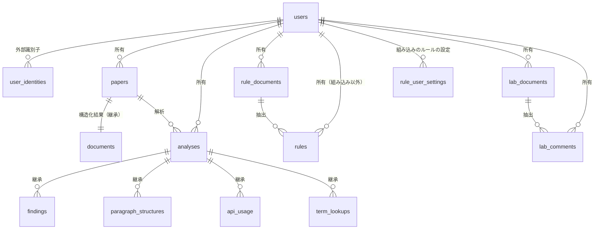
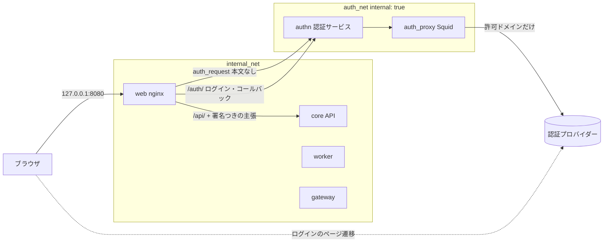

# アクセス制御設計：ゲストユーザーと個人データ

MongAI に認証・認可を入れるための設計の基準です。実装の PR はこの文書に沿って進め、方針を変えるときはこの文書を先に更新します。

- 状態：設計確定（2026-10-14。実装はまだ行っていない）。まだ決まっていない事項は第L章にまとめる
- 対象のコード：`upstream/main` の 0b3916e（API を `core/api/routers/` に分けた後）
- 関連：`docs/SPEC.md`（第2章 セキュリティ要件、3.1 入力）、`docs/demo.md`、`TODO.md`「認証・認可の準備」

---

## A. 目的・スコープ・用語

### A.1 目的

1. 論文・解析結果・ルール・専門知識を個人のデータとして扱い、所有者本人だけが閲覧・操作できるようにする
2. ログインしていない利用者（ゲスト）が、共通デモを副作用なしで閲覧できるようにする
3. 認証方式（Google、大学の SSO など）を後から差し替えられるよう、アプリ内部のユーザーと外部の認証プロバイダーを分ける
4. 既存のセキュリティ要件（SPEC 第2章：論文を学外に出さない、ネットワーク分離、監査ログの追記専用）を保つ

### A.2 用語

| 用語 | 定義 |
|---|---|
| ゲスト | 有効な認証情報を提示していない利用者。DB にレコードを持たない。共通デモの閲覧だけができる |
| 認証済みユーザー | 認証プロバイダーで本人確認が済み、内部ユーザーに対応付けられた利用者 |
| 内部ユーザーID | MongAI が発行する、利用者の不変の識別子（例：`U-<32桁の16進>`）。データの所有者はこの ID で記録する。メールアドレスや外部の識別子は使わない |
| 外部識別子 | 認証プロバイダーが発行する、安定した利用者の識別子。OIDC の `iss`（発行者）と `sub`（主体）の組 |
| データ所有者 | 個人リソースを作成した内部ユーザー。所有者は作成時に決まり、API では変更できない |
| 共通デモ | `core/sample/` に収めた合成論文と保存済みの解析結果（現在は `SAMPLE_DOC_ID = 67dc154e691a70a2`、`SAMPLE_ANALYSIS_ID = A-b24e9eb4103f`）。アプリケーションが管理し、個人には所有させない |
| 公開リソース | 誰でも読めて、誰も変更できないリソース。今回は共通デモ（とその付属物）だけ |
| 個人リソース | 所有者が1人いるリソース。所有者だけが読み書きできる |
| 隔離リソース | 認証の導入前に作られ、所有者が分からないリソース（第F章）。誰も API から読み書きできない |
| 認証（Authentication） | 「誰か」を確かめること。外部の認証プロバイダーと、その結果を受け取る仕組みが担う |
| 認可（Authorization） | 「その人がそのリソースにその操作をしてよいか」を決めること。`core` の API とワーカーが担う |

### A.3 スコープ

今回の実装の対象は次のとおりです。

- ゲストと認証済みユーザーの区別（FastAPI の依存性）
- すべての既存 API の認可（第C章）
- データモデルへの所有者・公開範囲の追加と、既存データの移行（第D・F章）
- 文書 ID の内容ハッシュからの分離（第E章）
- ワーカー・ルール・専門知識・前回解析の比較・gateway の承認キューと監査ログ・利用回数の個人別分離（第G章）
- 認証プロバイダーとの統合の枠組み（第H・I章）と、ログイン画面

今回の対象外は次のとおりです。

- 研究室単位の共有・共同編集、個人間の共有
- 管理者による個人データの閲覧（L.4）
- 利用者ごとの利用量の上限（クォータ）・レート制限
- 退会・データ保持期間の運用（L.6）
- 学外からの利用経路（Cloudflare Tunnel など。`TODO.md` の検討事項に残す）

---

## B. アクセス権限マトリクス

○＝許可、×＝拒否。括弧内は拒否時のステータス。主体は次の3つです。

- **ゲスト**
- **所有者**：そのリソースの所有者本人（共通デモには所有者はいない）
- **他者**：所有者以外の認証済みユーザー

共通デモについては「所有者」の列は無く、認証済みユーザーはすべて「他者」と同じ扱いになります。

### B.1 共通デモ

| データ・操作 | ゲスト | 認証済みユーザー | 備考 |
|---|---|---|---|
| デモ論文の PDF の閲覧・ダウンロード | ○ | ○ | `GET /api/documents/{doc_id}/paper.pdf` |
| デモの解析結果（集計・指摘・用語の照会結果）の閲覧 | ○ | ○ | 保存済みのものだけ |
| デモのエクスポート（CSV・JSON・テキストの要約・注釈付きPDF） | ○ | ○ | 保存済みの情報から生成。LLM・学外の通信・ジョブは使わない |
| デモの前回との差分 | ○（常に「前回なし」） | ○（同左） | 他人の解析を「前回」にしない（第G.5） |
| デモの外部通信ログ | ○（デモの解析 ID の記録だけ） | ○（同左） | 第C.6 |
| デモの指摘ステータスの変更 | ×（401） | ×（403） | 画面では、変更をブラウザのタブの中だけに反映して試せる（サーバーには送らない） |
| デモ論文の削除 | ×（401） | ×（403） | 現行でも 403 |
| デモ論文の再解析（新しい解析の開始） | ×（401） | ×（403） | **現行では誰でも開始できる**（第M章） |

### B.2 個人データ

| データ・操作 | ゲスト | 所有者 | 他者 | 備考 |
|---|---|---|---|---|
| 論文のアップロード | ×（401） | ○（作成者が所有者になる） | — | |
| 論文の PDF の閲覧 | ×（404） | ○ | ×（404） | ID の存在を明かさない |
| 論文の削除 | ×（401） | ○ | ×（404） | |
| 新規解析の開始 | ×（401） | ○（自分の論文だけ） | ×（404） | |
| 解析の一覧 | 共通デモだけ | 自分の解析＋共通デモ | — | 一覧は主体ごとに絞る |
| 解析の詳細・指摘・用語の照会結果 | ×（404） | ○ | ×（404） | |
| 指摘ステータスの更新 | ×（401） | ○ | ×（404） | |
| エクスポート（CSV・JSON・テキスト・注釈付きPDF） | ×（404） | ○ | ×（404） | |
| 解析履歴の差分表示 | ×（404） | ○（自分の解析どうしだけ） | ×（404） | |
| ルール・ルール資料の参照 | ×（401） | ○（自分のもの＋組み込みのルール） | ×（一覧に出ない） | 個別に取得する API は無い |
| ルール・ルール資料の編集・登録・削除 | ×（401） | ○ | ×（404） | 組み込みのルールは本人の設定だけを変える（第D.5） |
| 専門知識（資料・過去の指摘）の参照 | ×（401） | ○ | ×（一覧に出ない） | 機能名は「研究室知識」でも所有は個人 |
| 専門知識の登録・削除 | ×（401） | ○ | ×（404） | 既存 API には過去の指摘の「編集」は無い |
| おいとまAPIの利用記録（今日の利用） | ×（401） | ○（自分の分だけ） | — | 全体の合計は一般の利用者には見せない（G.9） |
| 外部通信の監査ログ | デモの記録だけ | ○（自分の解析の記録だけ） | ×（一覧に出ない） | 追記専用は保つ |
| 外部通信の承認キューの閲覧 | ×（401） | ○（自分の解析が積んだ要求だけ） | ×（一覧に出ない） | |
| 承認キューの承認・却下 | ×（401） | ○ | ×（404） | |
| 隔離リソース（所有者不明の既存データ） | ×（404） | ×（404） | ×（404） | 第F章 |

既存 API に無い操作（論文のメタデータの編集、過去の指摘の編集、解析の個別削除、ルールの新規の手入力など）は、この表に含めていません。追加するときは、この表と第C章に行を足してから実装します。

---

## C. API ごとの認可仕様

### C.1 共通の判定順序

すべての API は次の順に判定します。順序を固定することで、ゲストによる ID の存在確認（403 と 404 の違いから推測すること）を防ぎます。

1. **認証情報の検証**：認証情報が提示されていて無効（署名不正・期限切れ・未知のユーザー・無効化されたユーザー）なら **401**。ゲストとして扱わない
2. **認証の要否**：認証必須の操作をゲストが要求したら **401**（リソースを引く前に返す）
3. **リソースの取得**：主体が読めるリソースだけを引く（SQL の条件で絞る）。見つからない・他人のもの・隔離されたものは区別せず **404**
4. **共通デモへの変更**：読めるが公開リソースで変更できないなら **403**
5. **業務上の検査**：形式（413・415・422）、状態（409）

ゲストが個人リソースの読み取りを要求した場合、手順2で弾く API（認証必須）と、手順3で 404 を返す API（ゲストにも開いている読み取り）があります。共通デモの読み取りを許すエンドポイントでは、ゲストにとって個人リソースは「存在しない」ので 404 を返します。

### C.2 依存性の名前（第H章で定義）

- `PrincipalDep`：ゲストか認証済みユーザー。無効な認証情報は 401
- `UserDep`：認証済みユーザーだけ。ゲストは 401
- `readable_analysis(...)` / `owned_analysis(...)` など：リソースの取得と所有権の検査（第H.4）

### C.3 API 一覧と認可

`core/api/routers/` と `core/api/main.py` にある全 30 エンドポイントです（`tests/unit/test_api_routes.py` の `EXPECTED` と一致することを確認済み）。

凡例：ゲスト／認証済み＝その主体に開くか。所有権＝個人リソースの所有権の検査が要るか。

#### `core/api/main.py`

| メソッド・パス | ゲスト | 認証済み | 所有権 | 共通デモ | 拒否時 | 漏えいの懸念 |
|---|---|---|---|---|---|---|
| `GET /api/healthz` | ○ | ○ | 不要 | — | — | なし。無効な認証情報があっても 200 を返してよい（監視用。例外として手順1を行わない） |

#### `routers/documents.py`

| メソッド・パス | ゲスト | 認証済み | 所有権 | 共通デモ | 拒否時 | 漏えいの懸念 |
|---|---|---|---|---|---|---|
| `POST /api/documents` | × | ○ | 作成者を所有者にする | デモと同じ PDF でも新しい個人の文書になる（第E章） | ゲスト 401 | 現行は内容ハッシュが ID なので、同じ PDF をアップロードした他人と `papers` の行・PDF ファイルを共有する（第M章） |
| `GET /api/documents/{doc_id}/paper.pdf` | ○（デモだけ） | ○ | 要 | 誰でも取得できる | 他人・隔離・存在しない：404 | **現行は DB を引かずにファイルの有無だけで返す**。ID を知っていれば誰の PDF でも取れる。必ず `papers` の行を主体の条件で引いてからファイルを読む |
| `DELETE /api/documents/{doc_id}` | × | ○ | 要 | 403 | ゲスト 401、他人 404、デモ 403、解析中 409 | 現行は同じ PDF を共有する他人の解析まで消える。所有権の確認の前にファイルを消さない（第E.6） |

#### `routers/usage.py`

| メソッド・パス | ゲスト | 認証済み | 所有権 | 共通デモ | 拒否時 | 漏えいの懸念 |
|---|---|---|---|---|---|---|
| `GET /api/usage/today` | × | ○（自分の分） | 主体で集計 | — | ゲスト 401 | 現行は全員の合計（`api_usage_daily`）。他人の利用状況（いつ・どれだけ解析したか）が分かる。利用者別の集計に変える（第G.9）。フロントエンドはゲストには表示しない |

#### `routers/analyses.py`

| メソッド・パス | ゲスト | 認証済み | 所有権 | 共通デモ | 拒否時 | 漏えいの懸念 |
|---|---|---|---|---|---|---|
| `POST /api/analyses` | × | ○ | `doc_id` の論文が自分のもの | 403 | ゲスト 401、他人の論文 404、デモ 403 | 現行はデモ論文の再解析ができ、できた解析も `sample=True` になり削除できなくなる |
| `GET /api/analyses` | ○（デモだけ） | ○（自分＋デモ） | SQL で絞る | 全員の一覧に含める | — | 現行は全員の解析（最新100件）を返す。件数の上限は絞り込みの**後**にかける |
| `GET /api/analyses/{analysis_id}` | ○（デモだけ） | ○ | 要 | 閲覧可。`previous` は常に `null` | 404 | `previous`（前回の解析 ID・件数）に他人の解析が入りうる（第G.5）。`external_requests` は gateway の件数（その解析 ID の分だけ） |
| `GET /api/analyses/{analysis_id}/terms` | ○（デモだけ） | ○ | 要 | 保存済みの記録だけ。承認キューの決定を重ねない | 404 | 現行の `term_decisions` は `request_id` だけで重なり、所有者の区別が無い（第G.8） |
| `GET /api/analyses/{analysis_id}/diff` | ○（デモだけ） | ○ | 要（比較先も同じ所有者） | 常に「前回なし」 | 404 | 現行の `find_previous` は全員の解析からタイトル・ファイル名の一致で選ぶ |

#### `routers/findings.py`

| メソッド・パス | ゲスト | 認証済み | 所有権 | 共通デモ | 拒否時 | 漏えいの懸念 |
|---|---|---|---|---|---|---|
| `GET /api/analyses/{analysis_id}/findings` | ○（デモだけ） | ○ | 要（解析から継承） | 閲覧可 | 404 | なし（解析の検査を通れば十分） |
| `PATCH /api/analyses/{analysis_id}/findings/{finding_id}` | × | ○ | 要 | 403 | ゲスト 401、他人 404、デモ 403、理由なしの却下 422 | **現行はデモの指摘のステータスを誰でも変えられる**。共有のデモを書き換えられる経路を残さない |

#### `routers/exports.py`

| メソッド・パス | ゲスト | 認証済み | 所有権 | 共通デモ | 拒否時 | 漏えいの懸念 |
|---|---|---|---|---|---|---|
| `GET /api/analyses/{analysis_id}/findings.csv` | ○（デモだけ） | ○ | 要 | 閲覧可 | 404 | なし |
| `GET /api/analyses/{analysis_id}/findings.json` | ○（デモだけ） | ○ | 要 | 閲覧可 | 404 | ファイル名・タイトルを含む。所有権の検査で足りる |
| `GET /api/analyses/{analysis_id}/report.txt` | ○（デモだけ） | ○ | 要 | 閲覧可。前回との比較は含めない | 404 | `previous_and_diff` を使うため、第G.5 の修正が前提 |
| `GET /api/analyses/{analysis_id}/annotated.pdf` | ○（デモだけ） | ○ | 要 | 閲覧可 | 404、PDF が無ければ 404 | 保存済みの PDF と指摘から生成するだけで、LLM・学外の通信は無い。ただし CPU を使うため、ゲストが繰り返し要求すると負荷になる（デモの生成結果は保存して返す。第M章） |

#### `routers/gateway.py`

| メソッド・パス | ゲスト | 認証済み | 所有権 | 共通デモ | 拒否時 | 漏えいの懸念 |
|---|---|---|---|---|---|---|
| `GET /api/audit-log` | △（`analysis_id` がデモの解析 ID のときだけ） | ○（自分の分） | 要 | デモの解析 ID の記録だけ返す | ゲストが `analysis_id` なし・デモ以外を指定：401（C.6） | 現行は `analysis_id` を省くと**全員の**外部要求（照会した用語・引用文献のタイトル）を返す。照会した用語から未発表の研究内容が推測できる |
| `GET /api/gateway/queue` | × | ○（自分の分） | 要 | デモの要求は積まれない | ゲスト 401 | 現行は全員の承認待ちの要求（用語・`doc_id`・`analysis_id`）を返す |
| `POST /api/gateway/queue/{request_id}/{action}` | × | ○ | 要（要求を積んだ解析が自分のもの） | — | ゲスト 401、他人 404、gateway の失敗 502 | 現行は誰でも他人の要求を承認・却下できる。承認は学外への送信を伴うので、所有者以外に許さない |

#### `routers/rules.py`

| メソッド・パス | ゲスト | 認証済み | 所有権 | 共通デモ | 拒否時 | 漏えいの懸念 |
|---|---|---|---|---|---|---|
| `GET /api/rules` | × | ○（自分のルール＋組み込みのルールに本人の設定を重ねたもの） | 要 | — | ゲスト 401 | 現行は全員のルールと、組み込みのルールに統合された**他人の資料のファイル名**（`sources`）が見える |
| `PATCH /api/rules/{rule_id}` | × | ○ | 要（組み込みのルールは本人の設定を変える） | — | ゲスト 401、他人 404 | 現行は組み込みのルールの有効・無効が全員で共有される |
| `POST /api/rules/bulk-status` | × | ○ | ID ごとに要 | — | ゲスト 401。他人の ID は現行の「見つからない ID は無視する」と同じく黙って除く | 他人の ID の存在を応答で明かさない（応答は更新したルールだけ） |
| `GET /api/rule-documents` | × | ○（自分の分） | 要 | — | ゲスト 401 | 現行は全員の資料のファイル名が見える |
| `POST /api/rule-documents` | × | ○ | 作成者を所有者にする | — | ゲスト 401、413、415 | |
| `DELETE /api/rule-documents/{document_id}` | × | ○ | 要 | — | ゲスト 401、他人 404、抽出中 409 | ルールの削除も同じ所有者の条件で行う |

#### `routers/lab.py`

| メソッド・パス | ゲスト | 認証済み | 所有権 | 共通デモ | 拒否時 | 漏えいの懸念 |
|---|---|---|---|---|---|---|
| `GET /api/lab/documents` | × | ○（自分の分） | 要 | — | ゲスト 401 | 現行は全員が同じ資料・過去の指摘を見る |
| `POST /api/lab/documents` | × | ○ | 作成者を所有者にする | — | ゲスト 401、413、415 | |
| `DELETE /api/lab/documents/{document_id}` | × | ○ | 要 | — | ゲスト 401、他人 404、取り込み中 409 | 連動して消すルール（`rules.delete_document`）も同じ所有者の条件で消す |
| `GET /api/lab/comments` | × | ○（自分の分） | 要 | — | ゲスト 401 | 同上 |
| `DELETE /api/lab/comments/{comment_id}` | × | ○ | 要 | — | ゲスト 401、他人 404 | |

### C.4 ゲストに開くエンドポイントのまとめ

ゲストが 200 を受け取れるのは次だけです。これ以外はゲストに対して 401 か 404 になります。

- `GET /api/healthz`
- `GET /api/analyses`（共通デモだけを含む一覧）
- `GET /api/analyses/{共通デモの解析ID}` とその下の読み取り（`/findings`、`/terms`、`/diff`、`/findings.csv`、`/findings.json`、`/report.txt`、`/annotated.pdf`）
- `GET /api/documents/{共通デモの文書ID}/paper.pdf`
- `GET /api/audit-log?analysis_id={共通デモの解析ID}`

`/api/docs` と `/api/openapi.json`（FastAPI の自動生成）はデータを含まないので、公開のままにします。

### C.5 ステータスコードを選んだ理由

- **ゲストの変更操作は 403 でなく 401**：共通デモへの変更でも、ゲストには 401 を返します。手順2で認証の要否を先に判定するので、ゲストはリソースの存在・種類を知ることができません。認証済みユーザーが共通デモを変更しようとした場合は 403 です
- **ゲストが個人リソースを読もうとしたときは 404**：読み取り系の API はデモのためにゲストにも開くので、ゲストにとって個人リソースは「存在しないもの」として 404 を返します。401 を返すと「その ID は存在し、ログインすれば見られるかもしれない」と分かってしまいます
- **`bulk-status` は他人の ID を黙って除く**：現行の仕様（見つからない ID は無視）と同じ扱いにし、他人の ID の存在を明かしません
- **`healthz` は手順1を行わない**：Docker の healthcheck・監視が使うため、認証の状態に関わらず応答します
- **ゲストの `audit-log` を 401 にする場合**：`analysis_id` を省いた要求は「自分の分の一覧」を意味するので、ゲストには 401 を返します（ゲストには「自分の分」が無い）。デモ以外の `analysis_id` を指定した場合も、存在の有無を明かさないよう同じ 401 にします

### C.6 共通デモの外部通信ログ

共通デモの解析は `install_sample` で取り込んだものです。デモを作った環境以外の gateway には、この解析の記録がありません。また、デモの再解析を 403 にするので、デモの解析 ID で gateway に要求を出す経路は無くなります（新しい解析には新しい ID が付きます）。したがって、デモの解析 ID で絞った監査ログは、合成論文に対する過去の記録だけで、個人データを含みません。

ゲストは、`analysis_id` がデモの解析 ID のときだけ、その ID の記録を受け取れます。デモの外部通信ログの「見本」を `core/sample/` に別途収めることはしません。

---

## D. データモデル

### D.1 方針

- ルートのリソースには所有者を直接持たせる（`papers`、`analyses`、`rule_documents`、`rules`、`lab_documents`、`lab_comments`）
- 子のリソースは親から継承する（`findings`、`paragraph_structures`、`api_usage`、`term_lookups` は `analyses` から、`documents` は `papers` から）
- 子に所有者の列を重ねて持たせない。子を読むときは必ず親（解析）の所有権を検査してから読む（現行の `analysis_or_404` → `get_findings` の流れを、所有権つきに置き換える）

理由は次のとおりです。

- `analyses` は `papers` から導出できますが、一覧（`GET /api/analyses`）と前回解析の検索を SQL の条件だけで絞るため、`analyses` にも直接持たせます。作成時に `papers.owner_user_id` と同じ値を入れ、移行と単体テストで一致を確認します
- `rules` と `lab_comments` は、ワーカーが解析の材料として一括で読みます（`list_rules(status="approved")`、`comment_vectors(...)`）。親を辿る結合を毎回書くと条件の書き忘れが起きやすいので、直接持たせて `WHERE owner_user_id = ?` を必須にします
- 指摘などの子は、必ず解析 ID を指定して読み、件数も多いので、継承で足ります。列を重ねると、親と子で所有者が食い違う状態が生まれます

### D.2 ユーザーと認証プロバイダーの対応付け

```sql
CREATE TABLE users (
    user_id TEXT PRIMARY KEY,           -- 'U-' + uuid4 の32桁。作成後に変えない
    display_name TEXT,                  -- 表示用。所有権の判定に使わない
    email TEXT,                         -- 表示・連絡用。主キーにも一意制約にも使わない
    status TEXT NOT NULL DEFAULT 'active' CHECK (status IN ('active', 'disabled')),
    created_at TEXT NOT NULL,
    last_login_at TEXT
);

CREATE TABLE user_identities (
    issuer TEXT NOT NULL,               -- OIDC の iss（例：https://accounts.google.com）
    subject TEXT NOT NULL,              -- OIDC の sub（プロバイダー内で不変の ID）
    user_id TEXT NOT NULL REFERENCES users(user_id),
    created_at TEXT NOT NULL,
    last_login_at TEXT,
    PRIMARY KEY (issuer, subject)
);
```

- 所有者の記録・判定は `user_id` だけで行う。メールアドレスは変わることがあり、別人に再利用されることもあるため使わない
- 1人が複数の外部識別子を持てる（認証方式を移行するときに、新しいプロバイダーの識別子を同じ `user_id` に追加する）
- 外部識別子からの自動の紐付け（同じメールアドレスなら同じ人とみなす、など）は行わない。移行時の紐付けは、本人が両方でログインして確認する手順か、管理者の操作で行う（具体的な手順は L.1 とあわせて決める）
- `status = 'disabled'` のユーザーの認証情報は手順1で 401 にする

### D.3 公開範囲の列

所有者を持つルートの表に、次の2列を加えます。

```sql
owner_user_id TEXT REFERENCES users(user_id),
visibility TEXT NOT NULL DEFAULT 'private'
    CHECK (visibility IN ('private', 'public_demo', 'quarantined')),
CHECK (
    (visibility = 'private' AND owner_user_id IS NOT NULL) OR
    (visibility IN ('public_demo', 'quarantined') AND owner_user_id IS NULL)
)
```

| `visibility` | 所有者 | 読める主体 | 変更できる主体 |
|---|---|---|---|
| `private` | 必須 | 所有者だけ | 所有者だけ |
| `public_demo` | なし | 全員（ゲストを含む） | 誰もいない（API からは不可） |
| `quarantined` | なし | 誰もいない | 誰もいない |

- `public_demo` は `install_sample`（アプリケーション）だけが設定する。API から `visibility` を変える経路は作らない
- 共通デモの判定は、この列に加えて、現行の `core/sample/is_sample()`（ID が固定値かどうか）でも行う（二重の確認）。変更系の API は、どちらか一方でもデモと判定されたら 403 にする
- SQLite の `CHECK` は `ALTER TABLE ADD COLUMN` では後から付けられないため、表を作り直す移行で付ける（第F.3）

### D.4 表ごとの所有者

| 表（ファイル） | 所有者の持ち方 | 公開デモ | 備考 |
|---|---|---|---|
| `papers`（`core/store/db.py`） | 直接（`owner_user_id`、`visibility`） | `public_demo` の行が1つ | 主キーは `doc_id`（ランダム。第E章）。内容ハッシュは `content_sha256` 列に分ける |
| `documents` | `papers` から継承（`doc_id` が同じ） | デモの構造化結果 | `doc_id` で `papers` と1対1 |
| `analyses` | 直接（`owner_user_id`、`visibility`）。`papers` と一致させる | `public_demo` の行が1つ | |
| `findings`・`paragraph_structures`・`api_usage`・`term_lookups` | `analyses` から継承 | 継承 | `findings.doc_id` 列もあるが、所有権の判定には使わない |
| `term_decisions` | `owner_user_id` を直接持たせる（第G.8） | 使わない（デモには重ねない） | 現行は `request_id` だけが主キー |
| `api_usage_daily` | 新しい表 `api_usage_daily_by_user` を作る（第G.9） | — | 既存の表は全体の集計として残す |
| `rule_documents`（`core/rules/store.py`） | 直接 | なし | |
| `rules` | 直接。組み込みのルールは所有者なし（下記） | なし | |
| `lab_documents`（`core/lab/store.py`） | 直接 | なし | |
| `lab_comments` | 直接 | なし | 埋め込み（`embedding` 列）も同じ行にあるため、同じ条件で絞られる |
| gateway の `audit`・`queue`（`gateway/audit.py`） | `owner_id` を直接持たせる（第G.7） | デモの解析 ID の記録は `owner_id` なし | `audit` は追記専用のまま |
| gateway の `cache` | 所有者なし（公開情報の応答） | — | 第G.7 |

### D.5 組み込みのルール

組み込みのルール（`core/rules/models.py` の `BUILTIN_RULES`）は全員が使うので、所有者を持ちません。一方、現行では次の2つが全員で共有されています。

- 有効・無効の状態（`PATCH /api/rules/{rule_id}` で変えると全員に効く）
- 統合された出典（ルール資料の抽出で、同じ種類の機械判定のルールは組み込みのルールに `sources` として統合される。他人の資料のファイル名が残る）

組み込みのルールの本体は共有のまま（`owner_user_id IS NULL`、`builtin = true`）とし、利用者ごとの設定を別の表に持ちます。利用者ごとにルールを複製する案は、組み込みのルールを直したときに既存の利用者へ反映されないため採りません。

```sql
CREATE TABLE rule_user_settings (
    user_id TEXT NOT NULL REFERENCES users(user_id),
    rule_id TEXT NOT NULL,              -- 組み込みのルールの ID
    status TEXT,                        -- NULL なら組み込みの既定値
    extra_sources TEXT NOT NULL DEFAULT '[]',  -- この利用者の資料から統合された出典
    updated_at TEXT NOT NULL,
    PRIMARY KEY (user_id, rule_id)
);
```

- `GET /api/rules` は、組み込みのルールに本人の設定を重ねて返す
- ルールの抽出（`core/rules/extract.py` の `merge_rules`）で組み込みのルールに統合するときは、共有の本体ではなく本人の `rule_user_settings.extra_sources` に足す
- 解析時のルールセット（`RuleStore.ruleset_version`）も利用者ごとに計算する

### D.6 ER 図



---

## E. PDF の識別子とデータの分離

### E.1 現状

- `core/store/files.py` の `doc_id_for()` は、PDF の SHA-256 の先頭16桁を文書 ID にする
- `save_paper()` は、同じ ID のファイルがあれば上書きしない。`Store.save_paper()` は `ON CONFLICT(doc_id) DO UPDATE SET filename=...` でファイル名だけを更新する
- `core/ingest/pipeline.py` も、`doc_id` を渡されなければ同じ計算をする（ワーカーは `record.doc_id` を渡している）
- 共通デモの ID（`67dc154e691a70a2`）も内容ハッシュで、`install_sample` が PDF のハッシュと照合している

この方式では、同じ PDF をアップロードした別々の利用者が同じ `doc_id`・同じ `papers` の行・同じファイルを共有し、ファイル名の上書き・解析の混在・削除の巻き添えが起きます。`demo/demo_paper_ja.pdf` は `core/sample/paper.pdf` と同一のファイル（確認済み）なので、デモの手順どおりにデモ論文をアップロードすると、現行では**共通デモの文書に個人の解析が付く**ことにもなります。

### E.2 文書 ID と内容ハッシュを分ける

- 新しい文書 ID は、アップロードごとに `secrets.token_hex(8)`（16桁の16進、64ビットの乱数）で発行する
- 内容ハッシュは `papers.content_sha256`（64桁）に保存する。一意制約は付けない。`(owner_user_id, content_sha256)` に索引を張り、将来「同じ人が同じ PDF を再アップロードしたとき、既存の文書を示す」機能に使える（今回は実装しない）
- 挿入時に主キーの衝突が起きたら、ID を作り直して再試行する（共通デモの ID との衝突もこれで防がれる）
- `core/ingest/pipeline.py` の既定値（ハッシュからの計算）は、`doc_id` を必須の引数にして廃止する

**16桁の16進のままにする理由**：gateway の要求のスキーマ（`shared/schemas.py` の `GatewayRequest.doc_id`、`gateway/manuscripts.py` の `ManuscriptGuard.doc_id`）が `^[0-9a-f]{16}$` を要求しており、形式を変えると gateway のスキーマとセキュリティテストの変更が要ります。ID は秘密ではなく、アクセス制御は所有権の検査で行うので、64ビットの乱数で十分です。形式を `D-<32桁>` などに変える案は、gateway のスキーマ変更と同時なら可能です（今回は見送る）。

**ID の推測について**：ID を推測されても、所有権の検査で 404 になるので、ID の推測困難性には頼りません。ただし、内容ハッシュ由来の ID は「PDF を持っている人なら ID を計算できる」ので、ランダムにすることで副次的にこの経路も閉じます。

### E.3 個人間のファイル衝突の防止

- ファイルのパスは現行どおり `data_private/papers/<doc_id>.pdf`。`doc_id` が利用者ごと・アップロードごとに異なるので、他人のファイルと衝突しない
- 所有者ごとのディレクトリ（`papers/<user_id>/...`）にはしない。所有権の判定を DB の1か所に集め、パスから所有者を推測する二重の仕組みを作らないため
- `paper_path()` の形式の検査（`[0-9a-f]{16}` の完全一致）は残す。パスを組み立てる値は、必ず DB から引いた `doc_id` を使う

### E.4 PDF の保存先の安全性

- `data_private` ボリュームは `core`・`worker` にだけマウントする現行の構成を保つ（`searcher`・`gateway`・認証サービスにはマウントしない）
- ルール資料・専門知識の資料（`data_private/rules/`、`data_private/lab/`）の ID（`RD-`・`LD-` ＋12桁）はすでにランダムで、`core/ingest/textdoc.py` で形式を検査している。所有権は DB で判定する

### E.5 共通デモの PDF との衝突防止

- 共通デモは固定の ID（`67dc154e691a70a2`）と `visibility = 'public_demo'` のまま残す
- 新しいアップロードはランダムな ID になるので、デモと同じ PDF をアップロードしても、新しい個人の文書になる
- `install_sample` は、デモの ID の行が既にあり、それが `public_demo` でない場合は、取り込みを止めてログに残す（上書きしない）

### E.6 削除の順序

1. 主体が所有する `papers` の行を引く（`WHERE doc_id = ? AND owner_user_id = ? AND visibility = 'private'`）。無ければ 404
2. 共通デモなら 403（`visibility` は `private` に絞っているので通常は来ないが、`is_sample()` でも確かめる）
3. トランザクション（`BEGIN IMMEDIATE`）で、解析が順番待ち・実行中でないことを確かめ（409）、子 → 解析 → 文書 → 論文の順に消す。`DELETE` の条件にも `owner_user_id` を入れる
4. コミットの**後**に PDF ファイルを消す

所有権を確かめる前にファイルは消しません。ファイルの削除に失敗しても、DB の状態は戻しません（ファイルだけが残っても、閲覧する経路が無いので漏えいにはなりません）。孤立したファイルは別のコマンドで掃除します。

アップロードは逆の順で、ID の発行 → 一時ファイルへの書き込みと名前の変更 → DB への所有者つきの挿入、の順に行います。挿入に失敗したらファイルを消します。

---

## F. 既存データの移行方針

### F.1 基本方針

- 認証導入前のデータ（所有者不明）は、最初にログインしたユーザーに自動で割り当てない
- 公開扱いにもしない
- 移行では `visibility = 'quarantined'`（所有者なし）にする。誰も API から読めない
- 所有者を決めるのは、運用者が明示的に行う「引き取り」の操作だけ

### F.2 行の分類

次の表のとおり分類します。組み込みのルールの有効・無効の変更、デモの指摘のステータス、デモ論文のファイル名は、移行で元の状態に戻します（今の設定は、誰が変えたか分からないため引き継ぎません）。論文・解析結果は消さず、隔離します。

| 対象 | 判定 | 移行後 |
|---|---|---|
| 共通デモの論文 | `doc_id = SAMPLE_DOC_ID` | `public_demo`。ファイル名・アップロード日時を `core/sample/analysis.json` の値に戻す（現行では再アップロードでファイル名が上書きされている可能性がある） |
| 共通デモの解析 | `analysis_id = SAMPLE_ANALYSIS_ID` | `public_demo` |
| デモ論文に付いた、デモ以外の解析 | `doc_id = SAMPLE_DOC_ID` かつ `analysis_id != SAMPLE_ANALYSIS_ID` | `quarantined`。誰かがデモ論文をアップロードして解析したもの。**公開にしない** |
| デモ論文に付いた指摘のステータスの変更 | デモの解析の `findings` | `core/sample/findings.json` の状態に戻す（現行では誰でも変更できたため） |
| そのほかの論文・解析 | 上記以外 | `quarantined` |
| ルール資料・ルール・専門知識 | すべて | `quarantined` |
| 組み込みのルール | `builtin` | 共有の本体を `BUILTIN_RULES` の既定値に戻す。現行の有効・無効の変更と統合された出典は、どの利用者の設定にも移さない（引き取りの対象にする） |
| `term_decisions` | すべて | 所有者なし。どの解析にも重ねない（引き取った解析の分だけ、引き取り時に所有者を付ける） |
| `api_usage_daily` | すべて | 全体の集計としてそのまま残す。利用者別の表には移さない |
| gateway の `audit`・`queue` | すべて | `owner_id` は NULL のまま。追記専用なので書き換えない。利用者の画面には出ない |

### F.3 SQLite のスキーマ変更の手順

現行の `Store.__init__` は、起動のたびに `ALTER TABLE ADD COLUMN` を行う方式で、`core` と `worker` の両方から同時に走ります。所有権の移行には `CHECK` 制約の追加（表の作り直し）が必要で、同時実行や途中の失敗に弱いため、方式を変えます。

1. `PRAGMA user_version` でスキーマの版を管理する
2. 移行は専用のコマンド（例：`make migrate`、コンテナ内で `python -m core.store.migrate`）で、`core`・`worker` を止めた状態で1回だけ実行する
3. `core`・`worker` は起動時に `user_version` を確かめ、期待する版より古ければ起動しない（認証なしの旧来の動作に戻らない）
4. 移行は1つのトランザクションで行う：新しい表を作る → 行を分類して写す → 古い表を消す → 名前を変える → 検証のクエリ → `user_version` を上げる → コミット
5. 次の検証のクエリを実行し、1つでも満たさなければロールバックする
   - `visibility = 'private' AND owner_user_id IS NULL` の行が0件
   - `visibility = 'public_demo'` の行がデモの ID だけ
   - `analyses.owner_user_id` と `papers.owner_user_id` の不一致が0件
   - 移行前後で各表の行数が一致

### F.4 バックアップとロールバック

- 移行コマンドは、最初に SQLite のオンラインバックアップ（`sqlite3.Connection.backup`）で `app_db` ボリューム内（例：`/data/db/backups/mongai-<日時>.sqlite3`）に複製を作る。学外にも、ホストの別の場所にも自動では送らない
- `data_private` のファイルは移行で動かさない（既存の `doc_id` はそのまま使うので、パスが変わらない）
- ロールバックは、コンテナを止め、バックアップを元の場所に戻し、移行前のイメージで起動する手順を README に書く
- gateway の監査ログ（`audit_log` ボリューム）は列の追加（`ALTER TABLE ADD COLUMN owner_id`）だけで、既存の行は変えない。`UPDATE`・`DELETE` を禁じるトリガーはそのまま残る

### F.5 移行に失敗したときに公開しない仕組み

- 移行の失敗 → `user_version` が上がらない → `core`・`worker` が起動しない（フェイルクローズ）
- `visibility` の既定値は `private`、`CHECK` で `private` には所有者が必須。所有者の無い行が誤って「誰でも読める」状態になることはない
- 読み取りの SQL は「主体の条件に一致するものだけを返す」形で書く（`owner_user_id = ? OR visibility = 'public_demo'`）。`quarantined` を明示的に除く条件を書かなくても、どの主体にも一致しない

### F.6 既存データの引き取り

- 運用者がコンテナ内で実行するコマンド（例：`make claim-legacy USER=<内部ユーザーID> DOCS=<doc_id,...>`）で、隔離された論文・解析（とその子）・ルール資料・専門知識に所有者を付ける
- 引き取りはログイン画面から行わない（最初のログインで自動的に割り当てる経路を作らない）
- 引き取りの記録（誰が・いつ・どの ID を）をログに残す
- 引き取られなかったデータの保持期間・削除は L.6 で決める

---

## G. 非同期処理と周辺データの分離

### G.1 共通の原則

- ワーカーは、ジョブの引数（ID）から DB の行を引き、その行の `owner_user_id` を正として以降の処理の主体にする。Redis のジョブの引数に所有者を含めても、それを信用しない
- ワーカーが材料として読むデータ（ルール、専門知識、前回の解析）は、すべて同じ所有者の条件で読む
- ストアのメソッドは、所有者を必須の引数にする（`list_rules(owner_user_id, status=...)` のように）。所有者を省ける版を残さない。全件を読む必要があるもの（`recover_interrupted` など）は名前で区別する

### G.2 Redis のジョブキュー

- 現行のジョブは `run_analysis(analysis_id)`、`run_rule_extraction(document_id)`、`run_lab_extraction(document_id)` で、`_job_id` に同じ ID を使っている。ID はランダムで利用者間で衝突しないので、この形を保つ
- Redis は `internal_net` にあり、論文の本文は積まない（ID だけ）。この方針を保つ
- 共通デモに対してジョブを積む経路を残さない（`POST /api/analyses` の 403）。ワーカー側でも、`public_demo`・`quarantined` の解析は実行せず失敗にする（二重の防御）

### G.3 解析ワーカー（`core/jobs.py` の `run_analysis`）

現行の処理と、必要な変更は次のとおりです。

| 処理 | 現行 | 変更 |
|---|---|---|
| 解析の記録を引く | `store.get_analysis(analysis_id)` | 所有者と `visibility` も引き、`private` 以外は実行しない |
| 承認済みのルール | `rule_store.list_rules(status="approved")`（全員の分） | 所有者のルール＋組み込みのルール（本人の設定を重ねたもの） |
| ルールの埋め込み | `rule_store.embeddings(status="approved")`（全員の分） | 同上の条件 |
| ルールセットの版 | `rule_store.ruleset_version()`（全体） | 所有者ごと |
| 過去の指摘と埋め込み | `lab_store.list_comments(...)`・`comment_vectors(...)`（全員の分） | `owner_user_id` で絞る |
| 用語の照会・書誌の照合 | gateway に `analysis_id`・`doc_id` を送る | `owner_id`（内部ユーザーID）も送る（第G.7） |
| 日ごとの利用回数 | `api_usage_daily` に加算 | 利用者別の表にも加算（第G.9） |
| 終了時の `gw.forget(doc_id)` | 文書 ID で gateway の照合情報を消す | 文書 ID がランダムになるので、他人の照合情報を消すことはない |

`startup` の `install_sample` と `recover_interrupted` は、全件を対象にしたままでかまいません（所有者は変えず、状態だけを変えるため）。

### G.4 ルールの抽出・承認・適用、専門知識の抽出・検索

- `run_rule_extraction`：資料の所有者を引き、`merge_rules` に渡す既存のルールを「所有者のルール＋組み込みのルール」に限る。統合先が組み込みのルールなら、本人の `rule_user_settings` に出典を足す（第D.5）。抽出したルールの `owner_user_id` は資料の所有者にする
- `run_lab_extraction`：`core/lab/extract.py` は過去の指摘（`lab_comments`）とルール（`rules`）の両方を作る。どちらも資料の所有者を付ける。`rule_store.list_rules()`・`rule_store.embeddings()`（統合の判定に使う既存のルール）を所有者で絞る
- `DELETE /api/lab/documents/{document_id}` が連動して消すルール（`rules.delete_document(document_id)`）も、所有者の条件を付ける
- 承認（`PATCH /api/rules/{rule_id}`、`bulk-status`）は所有者だけ。解析で使うのは、その解析の所有者が承認したルールだけ
- 専門知識の検索（類似の過去の指摘の検索）は、解析の所有者の `lab_comments` だけを候補にする

### G.5 前回の解析との比較

現行の `Store.find_previous()` は、全員の完了した解析から、同じ `doc_id`・同じタイトル・同じファイル名のどれかに一致する、より前のものを選びます。次の問題があります。

- ユーザー B の解析の「前回」に、ユーザー A の解析（同じタイトル・ファイル名）が選ばれ、A の指摘の件数・差分が B に見える
- 共通デモの解析の「前回」にも、デモより前に作られた個人の解析が選ばれうる。ゲストが個人の解析 ID・件数を見られることになる

そこで、次のように変えます。

- 比較の候補は、対象の解析と同じ所有者の `private` の解析だけにする（SQL の条件で絞る）
- 共通デモの解析は、比較の対象にも候補にもしない（デモの `previous` は常に `null`）
- 個人の解析の候補に共通デモを含めない（個人がデモ論文をアップロードしても、デモの解析を「前回」にしない）
- これを使うすべての API（`/analyses/{id}`、`/diff`、`/report.txt`）に効くよう、`core/api/queries.py` の `previous_and_diff` に所有者を渡す

### G.6 ベクトル DB

- SPEC 7 は LanceDB（名前空間ごとにテーブル）を想定し、`compose.yaml` も `core`・`worker` に `lancedb` ボリュームをマウントしているが、現行のコードは LanceDB を使っていない（埋め込みは SQLite の `rules.embedding`・`lab_comments.embedding` に JSON で保存している）。この差異は SPEC との差異として記録する（第N章）
- 現行の構成では、埋め込みは所有者を持つ行と同じ行にあるので、行の所有者の条件で一緒に絞られる
- 将来ベクトル DB を導入する場合：所有者の列を持たせ、検索の関数で所有者の条件を必須にする（テーブルを利用者ごとに分ける方式は、利用者の数だけテーブルが増えるので採らない）。先行研究の PDF を取り込む機能（SPEC 3.1）も個人のデータとして同じ扱いにする

### G.7 gateway の監査ログ・承認キュー・キャッシュ

現行の gateway（`gateway/audit.py`、`gateway/main.py`）は利用者を区別しません。

| 項目 | 現行 | 問題 |
|---|---|---|
| `GET /audit` | `analysis_id` を省くと全件（最新500件） | 全員の照会内容が見える |
| `GET /queue` | 全員の承認待ち | 全員の要求が見え、誰でも承認できる |
| `pending_for(request)` | 同じ内容（`request_hash`）の承認待ちがあれば、その `request_id` を返す | ユーザー B の要求が A の承認待ちにまとめられ、A が承認すると B の分も送られる（B の承認なしに B の解析の要求が送られたことになる） |
| `cache` | 応答を `request_hash` で全員共有 | 応答は公開情報（書誌・辞書の説明）。ただし「キャッシュ済み」という結果から、他の誰かが同じ語を照会したことが分かる |

これらを次のように変えます。

- `GatewayRequest`（`shared/schemas.py`）に `owner_id`（内部ユーザーID。形式 `^U-[0-9a-f]{32}$`）を加え、`audit`・`queue` に `owner_id` 列を追加する（`ALTER TABLE ADD COLUMN`。既存の行は NULL のまま）
- `owner_id` は gateway の中だけで使い、`searcher` には渡さない（現行の `send_to_searcher` は `request` だけを渡しているので、この形を保つ）。学外にも出ない
- `GET /audit`・`GET /queue`・`GET /audit/count` は `owner_id` を必須にする（デモの解析 ID の記録を読むときだけ、`analysis_id` の指定で `owner_id` なしを許す。gateway の側でも、`owner_id` も `analysis_id` も無い要求は拒否する）
- 承認・却下（`POST /queue/{request_id}/approve|reject`）は `owner_id` を受け取り、キューの項目の `owner_id` と一致しなければ 404 を返す
- `pending_for` は同じ `owner_id` の中だけでまとめる
- `cache` は全員で共有したままにする。応答は公開情報で、キャッシュの利用は学外への送信を伴わないため。「他の誰かが同じ要求をした」ことが分かる点は、受け入れたリスクとする（誰が・どの論文で照会したかは分からない）
- 監査ログの追記専用（`UPDATE`・`DELETE` を禁じるトリガー）は保つ。論文を削除しても監査ログは残る（現行と同じ）。退会後も残す（L.6）
- `core` の API（`routers/gateway.py`）は、主体の `user_id` を `owner_id` として gateway に渡す。gateway のスキーマ変更なので、`make test-security` を更新して通す

`core` は `audit_log` ボリュームを読み取り専用でマウントしていますが（`compose.yaml`）、現行の `core` は gateway の HTTP API 経由で監査ログを読んでいます。このマウントは今回は外さず、構成を見直すときに外します。

### G.8 用語の照会の決定（`term_decisions`）

- 現行は、承認・却下の結果を `request_id` ごとに保存し、同じ `request_id` を持つすべての解析の照会記録に重ねて表示する（`get_term_lookups`）
- G.7 の `pending_for` の変更で、別の利用者が同じ `request_id` を共有することは無くなる。加えて `term_decisions` に `owner_user_id` を持たせ、重ねるときに解析の所有者と一致するものだけを使う
- 共通デモの照会記録には、決定を重ねない（保存済みの状態を固定で表示する）。デモの照会記録の `request_id` と同じ ID の決定が後から記録されても、デモの表示は変わらない

### G.9 利用回数・トークン数の集計

- 解析ごとの利用回数（`api_usage`）は解析から継承する。他人の解析の分は解析の検査で見えない
- 日ごとの利用回数は、新しい表 `api_usage_daily_by_user(day, user_id, endpoint, model, requests, prompt_tokens, completion_tokens)` に、ジョブの所有者で加算する（ルール資料・専門知識の抽出は資料の所有者）
- 既存の `api_usage_daily`（全体の集計）は運用の確認用に残し、一般の利用者の API には出さない。全体の合計を管理者に見せるかどうかは L.4 で決める
- `GET /api/usage/today` は、主体の `user_id` の行だけを合計する

### G.10 ログ

- ログには `user_id` を書いてよい（学内のコンテナのログ）。メールアドレス・表示名・認証トークンは書かない
- 認可の拒否（401・403・404）のうち、他人のリソース ID を指定したもの（所有者はいるが主体と違う）は、`user_id` と ID を警告として記録する（推測の試行を見つけるため）。応答は 404 のまま

---

## H. 認証アーキテクチャ（`core` の側）

### H.1 リクエストの主体を表す型

```python
# core/auth/principal.py（新規）
from dataclasses import dataclass
from typing import Literal


@dataclass(frozen=True)
class Guest:
    kind: Literal["guest"] = "guest"


@dataclass(frozen=True)
class AuthenticatedUser:
    user_id: str  # 内部ユーザーID（U-...）
    kind: Literal["user"] = "user"


Principal = Guest | AuthenticatedUser
```

- 主体の型には、メールアドレスや外部識別子を含めない（認可の判定に使わせないため）
- 表示名などが必要な API（ログイン中の利用者の表示）は、`users` を引いて返す別のエンドポイント（`GET /api/me`）を PR3 で追加する

### H.2 外部の識別から内部ユーザーへの変換

```python
# core/auth/identity.py（新規）
class ExternalIdentity(BaseModel):
    issuer: str        # 認証プロバイダーの iss
    subject: str       # 認証プロバイダーの sub
    email: str | None  # 表示用
    email_verified: bool
    name: str | None


class AssertionVerifier(Protocol):
    def verify(self, token: str) -> ExternalIdentity: ...  # 失敗は InvalidAssertion


class UserDirectory(Protocol):
    def resolve(self, identity: ExternalIdentity) -> str: ...  # user_id。無効化・不許可は InvalidAssertion
```

- `AssertionVerifier`：認証サービス（第I章）が付けた署名つきの主張（短命の JWT）を検証する。`core` は外部の認証プロバイダーと直接通信しない
- `UserDirectory.resolve`：`user_identities` を `(issuer, subject)` で引く。無ければ、許可するメールのドメインに一致する場合だけ、初回のログインで `users` と `user_identities` を自動で作る（事前登録制にはしない。許可するドメインの一覧は L.1 で決める）。メールアドレスは確認済み（`email_verified`）のものだけを使う。`status = 'disabled'` なら失敗
- プロバイダーごとの違い（Google の `hd`、大学の SSO の属性など）は、認証サービスと `UserDirectory` の許可の条件に閉じ込め、ルーターには漏らさない

### H.3 依存性

```python
# core/api/dependencies.py に追加
def get_principal(request: Request, verifier: VerifierDep, users: UserDirectoryDep) -> Principal:
    token = request.headers.get(ASSERTION_HEADER)
    if token is None:
        return Guest()
    try:
        identity = verifier.verify(token)
        return AuthenticatedUser(user_id=users.resolve(identity))
    except InvalidAssertion:
        raise HTTPException(401, detail="invalid_session") from None  # ゲストにしない


def require_user(principal: PrincipalDep) -> AuthenticatedUser:
    if not isinstance(principal, AuthenticatedUser):
        raise HTTPException(401, detail="login_required")
    return principal


PrincipalDep = Annotated[Principal, Depends(get_principal)]
UserDep = Annotated[AuthenticatedUser, Depends(require_user)]
```

- 401 の `detail` を `invalid_session`（認証情報が無効）と `login_required`（ログインが必要）で分け、フロントエンドが「再ログイン」と「ログインの案内」を出し分けられるようにする
- **既定で拒否**：すべてのルーターに `PrincipalDep` か `UserDep` のどちらかを付ける。`tests/unit/test_api_routes.py` に「`/api/healthz` 以外のすべてのルートが `get_principal` に依存している」ことを確かめるテストを加え、付け忘れを CI で検出する
- 変更系のメソッド（`POST`・`PATCH`・`DELETE`）は、Cookie によるセッションを使う場合に CSRF の対策が要る。`SameSite=Lax` の Cookie に加え、`core` で `Origin`（または `Sec-Fetch-Site: same-origin`）を確かめる

### H.4 リソースの所有権の検査

`core/api/queries.py` の `analysis_or_404` を、主体と用途を受け取る形に置き換えます。

```python
def readable_analysis(store: Store, principal: Principal, analysis_id: str) -> AnalysisRecord:
    """主体が読める解析（自分の private か public_demo）。それ以外は 404。"""
    record = store.get_analysis_for(analysis_id, owner_user_id=user_id_or_none(principal))
    if record is None:
        raise HTTPException(404, detail="解析が見つかりません")
    return record


def owned_analysis(store: Store, user: AuthenticatedUser, analysis_id: str) -> AnalysisRecord:
    """主体が変更できる解析。読めない → 404、共通デモ → 403。"""
    record = readable_analysis(store, user, analysis_id)
    if record.visibility == "public_demo" or is_sample(record.doc_id):
        raise HTTPException(403, detail="デモの解析は変更できません")
    return record
```

- ストアの読み出し（`get_analysis_for` など）は、SQL に `WHERE analysis_id = ? AND (owner_user_id = ? OR visibility = 'public_demo')` を入れて絞る。全件を読んでから Python で絞る書き方をしない
- 子のリソース（指摘・用語・利用回数）を読む関数は、`readable_analysis` を通った `AnalysisRecord` を引数に取る形にし、ID の文字列だけで読めないようにする
- 論文（`papers`）・ルール資料・専門知識も同じ形の `readable_*`／`owned_*` を用意する

### H.5 テスト時の主体の差し替え

- 単体テストは、現行のストアと同じく `app.dependency_overrides[get_principal]` で主体を差し替える（例：`lambda: AuthenticatedUser("U-aaaa...")`、`lambda: Guest()`）
- 認証の検証そのもののテストは、テスト用の鍵で署名した主張を作り、`AssertionVerifier` の実物で検証する
- **`core` に「ヘッダーの利用者 ID をそのまま信用する」コードを置かない**。開発時の手動の確認は、開発用の鍵で署名するモックの認証サービス（`compose.dev.yaml` だけに入れる）で行い、`core` は本番と同じ検証の経路を通す
- 本番相当の構成で開発用の鍵を使わないよう、`core` は起動時に検証用の公開鍵の `kid` を確かめ、開発用（例：`dev-` で始まる）なら `MONGAI_ENV=production` のときに起動を止める

---

## I. ローカル運用と通信の分離

### I.1 守る条件

- `core`・`worker` の学外への通信を広げない（現行は `oitoma_proxy` 経由で おいとまAPI だけ）
- `searcher` に論文のデータを渡さない
- 未公開の論文を認証プロバイダーに送らない
- `web` の公開ポート（`127.0.0.1:8080`）を安易に増やさない
- CSP（`docker/web/nginx.conf`）と Docker のネットワーク分離を保つ
- 通信の経路を変えるときは、セキュリティテスト（`tests/security/`、`tests/unit/test_compose_structure.py`）を更新する

### I.2 構成の比較

| 案 | 概要 | `core` の学外通信 | 論文が認証側を通るか | 公開ポート | CSP | 評価 |
|---|---|---|---|---|---|---|
| A. `core` に OIDC を組み込む | `core` が認証プロバイダーとやり取りし、ID トークンを検証する | **増える**（トークンの交換・公開鍵の取得） | 通らない | 増えない | 変更なし | `core` の通信制限に反するので採らない |
| B. 認証サービスを分離（nginx の `auth_request`） | 新しいサービス `authn` がログインとセッションを担い、nginx が各要求の前に `authn` に問い合わせ、署名つきの主張を `core` に渡す | 増えない | 通らない（`auth_request` の副要求は本文を含まない） | 増えない（同じ `127.0.0.1:8080` の `/auth/` に置く） | `connect-src` の変更は不要（ログインはページ遷移） | **採用** |
| C. 認証のリバースプロキシを前段に置く（全通信を中継） | `oauth2-proxy` などを `web` の前に置き、全要求を中継させる | 増えない | **通る**（論文のアップロード・PDF が認証プロキシを経由する。学外には出ないが、学外と通信するコンテナを論文が通る） | 増えない | 変更なし | 論文が学外と通信するコンテナを通るので、B より劣る |
| D. ブラウザで直接プロバイダーにログイン（Supabase の JS など） | ブラウザが認証プロバイダーの API を呼び、得たトークンを `core` に送る | 増える（`core` がトークンを検証するための公開鍵の取得）か、公開鍵の手動配置 | 通らない | 増えない | **`connect-src` に学外のドメインを足す必要がある** | CSP を緩めるので採らない |

### I.3 採用する構成（案B）



- `authn`：ログイン（OIDC の認可コードフロー）、コールバック、ログアウト、セッションの Cookie を担う。nginx からの問い合わせ（`auth_request`）に対し、
  - セッションが無い → 200（主張なし。ゲスト）
  - セッションが有効 → 200 と、短命（数分）の署名つきの主張（JWT。`iss=mongai-authn`、`aud=mongai-core`、外部の `iss`・`sub`、`email`、`exp`）
  - セッションの Cookie があるが無効・期限切れ → 401（nginx はそのまま 401 を返す。ゲストにしない）
- nginx：`/api/` の要求に `auth_request` を掛け、`authn` の応答ヘッダーの主張を `proxy_set_header` で `core` に渡す。**ブラウザから来た同名のヘッダーは必ず上書き・削除する**
- `core`：主張の署名を、`authn` の公開鍵（読み取り専用でマウント）で検証する。非対称鍵（Ed25519 など）にし、`core` 側では主張を作れないようにする。`internal_net` 上の別のコンテナ（`worker`・`gateway` など）が `core` に直接要求しても、署名を作れないので成りすませない
- `authn` と、その外向きのプロキシ（`auth_proxy`。認証プロバイダーのドメインだけを許可）は、`data_private`・`app_db`・`audit_log` をマウントしない。`authn` に渡るのはセッションの Cookie とヘッダーだけ
- ユーザーの表（`users`・`user_identities`）は `core` の DB に置き、`authn` は外部の識別子を主張に載せるだけにする（`authn` は DB を持たないか、セッションだけを持つ）

ネットワークの名前・Squid の設定・`authn` の実装（自作か、`oauth2-proxy` の `auth_request` 対応を使うか）は、PR3 の実装の前に提案して確認を取ります。新しい外部通信の経路を作る変更なので、CLAUDE.md の「`internal: true` のネットワーク構成を崩す変更は事前に確認」にも当たります。`oauth2-proxy` を使う場合も、`core` が検証できる署名つきの主張を渡せること（未署名のヘッダーを信用しないこと）を条件にします。

### I.4 ローカル PC と研究室サーバー

| 形態 | 想定 | 認証 |
|---|---|---|
| 研究室サーバー（複数人） | `web` を `127.0.0.1:8080` に公開し、各自が SSH のポートフォワードで使う（README の現行の手順） | 案B が必要。ポートフォワード先のアドレス（`http://localhost:8080/auth/callback` など）を認証プロバイダーに登録する。全員が同じポート番号で転送する必要がある |
| ローカル PC（1人） | 自分の PC で `make up` | 案B をそのまま使うか、「ローカルの1人用モード」を設けるか（L.3） |

ローカルの1人用モード（固定の内部ユーザーを主体にする）は便利ですが、研究室サーバーで誤って有効にすると、ポートフォワードできる全員が同じ利用者になります。設けるなら明示的な設定を必須にし、サーバー用の設定（`MONGAI_ENV=production` など）と同時には起動しないようにします。

### I.5 認証プロバイダーの候補と注意点

最終的な認証プロバイダーはまだ決まっていません（L.1）。候補ごとの注意点だけを記録します。

- **Google（大学の Google Workspace アカウント）**：OIDC。`hd`（ドメイン）で学内のアカウントに限定できる。`sub` を外部識別子にする（メールアドレスにしない）
- **Supabase Auth ＋ Google OAuth**（`gomazarashi/location-message-app` で利用）：Supabase はホスティングされた外部サービスで、利用者のメールアドレス・名前が Supabase に保存される。論文は送らないが、個人情報の外部保存になる。ブラウザの SDK を使うと CSP の `connect-src` を緩める必要がある（案D）ので、使うなら `authn` のサーバー側のフローに限る
- **岡山大学の公式 SSO**：連携の可否・方式（SAML か OIDC か）・申請の手続きが不明。SAML の場合は `authn` で OIDC 相当の主張に変換する

いずれの場合も、`core` から見えるのは「`authn` が署名した、外部の `iss` と `sub` を含む主張」だけで、`core` の認可の実装は変わりません。

### I.6 CSP とヘッダー

- 現行の CSP（`connect-src 'self'`、`form-action 'self'`）は変えない。ログインはリンクによるページ遷移で認証プロバイダーに移るので、`connect-src` に学外のドメインは要らない。ログインを `<form>` の送信で始めると、ブラウザによっては `form-action` のリダイレクトの扱いで止まるので、リンク（`GET`）で始める
- セッションの Cookie は `HttpOnly`、`SameSite=Lax`、`Path=/`。HTTPS でない（`127.0.0.1` の HTTP）構成では `Secure` を付けられないため、研究室サーバーでの TLS の有無とあわせて PR3 で決める
- Service Worker（`frontend/public/sw.js`）は `/api/` 以下をキャッシュしない設計で、利用者ごとのデータが端末に残らない。この方針を保ち、`/auth/` も同じくキャッシュの対象外にする

---

## J. テスト計画

### J.1 方針

- 単体テスト（`tests/unit/`）で、`dependency_overrides` により主体を差し替え、全 API の認可を確かめる。ユーザー A・B の2人と、ゲスト、共通デモを使う
- テストのデータは合成データだけ（`tests/unit/pdf_factory.py` の PDF、`core/sample/` のデモ）。CLAUDE.md の規則どおり、実在の未発表論文は使わない
- ワーカー（`core/jobs.py`）は、偽の LLM クライアント（現行の `tests/unit/test_jobs.py` の方式）で、材料に他人のデータが入らないことを確かめる
- 認証の検証（`AssertionVerifier`）と、nginx・`authn` を通した結合テストは PR3 で追加する
- gateway の変更は `make test-security` に加える

### J.2 必須のシナリオ

| # | シナリオ | 期待される結果 |
|---|---|---|
| 1 | ゲストが `GET /api/analyses` を呼ぶ | 200。共通デモの解析1件だけ（`sample: true`）を含む |
| 2 | ユーザー A が解析を作った後、ゲストが `GET /api/analyses` を呼ぶ | 200。A の解析を含まない（件数・ID・ファイル名のいずれも出ない） |
| 3 | ゲストが `GET /api/documents/{デモの doc_id}/paper.pdf` を呼ぶ | 200。`application/pdf`、内容が `core/sample/paper.pdf` と一致 |
| 4 | ゲストが `GET /api/documents/{A の doc_id}/paper.pdf` を呼ぶ | 404（401 ではない）。本文は「論文のファイルが見つかりません」で、存在しない ID と区別できない |
| 5 | ゲストが `POST /api/documents` に PDF を送る | 401（`login_required`）。`data_private/papers` にファイルが増えず、`papers` に行が増えない |
| 6 | ゲストが `POST /api/analyses`（デモの doc_id、A の doc_id のそれぞれ）を呼ぶ | 401。ジョブのキュー（`FakeQueue`）に何も積まれない |
| 7 | ゲストが `PATCH /api/analyses/{デモの解析}/findings/{id}` を呼ぶ | 401。指摘のステータスが変わらない |
| 8 | ユーザー A が、デモの指摘の `PATCH`、`DELETE /api/documents/{デモの doc_id}`、`POST /api/analyses`（デモの doc_id）を呼ぶ | すべて 403。デモの指摘・論文・解析の件数が変わらず、キューに何も積まれない |
| 9 | ユーザー A が自分の論文の PDF・解析・指摘・エクスポートを取得する | すべて 200 |
| 10 | ユーザー B が A の `doc_id` の PDF、A の解析の詳細・指摘・用語・差分を取得する | すべて 404 |
| 11 | ユーザー B が A の解析の `findings.csv`・`findings.json`・`report.txt`・`annotated.pdf` を取得する | すべて 404 |
| 12 | ユーザー B が A の論文の削除、A の指摘の `PATCH`、A のルールの `PATCH`、A のルール資料・専門知識の削除を行う | すべて 404。A のデータは変わらない |
| 13 | A と B がそれぞれルール資料・専門知識を登録した後、`GET /api/rules`・`/api/rule-documents`・`/api/lab/documents`・`/api/lab/comments` を呼ぶ | それぞれ自分の分だけ。組み込みのルールの `sources` に相手の資料のファイル名が出ない |
| 14 | A が組み込みのルールを無効にした後、B が `GET /api/rules` を呼ぶ | B には既定の状態（有効）のまま |
| 15 | `bulk-status` で B が A のルールの ID を含めて送る | 200。応答に A のルールを含まず、A のルールの状態は変わらない |
| 16 | A と B のルール・過去の指摘がある状態で、A の論文の解析ジョブを実行する | 解析に渡るルール・過去の指摘・埋め込みが A のもの（と組み込み）だけ。`settings.ruleset` も A のルールセットの版 |
| 17 | B の資料からルールを抽出する（A に似たルールがある） | B のルールは A のルールに統合されず、B の所有の新しいルールになる |
| 18 | A が「paper.pdf」を解析済みの状態で、B が同じファイル名・同じタイトルの論文を解析する | B の解析の `previous` は `null`、`/diff` は「前回なし」、`report.txt` に前回の件数が出ない |
| 19 | デモより前の日時の個人の解析（デモと同じタイトル）がある状態で、ゲストがデモの解析・差分を取得する | `previous` は `null`。個人の解析の ID・件数が出ない |
| 20 | A と B が同じ PDF をアップロードする | 異なる `doc_id`。それぞれ自分の論文だけが見え、A が削除しても B の論文・PDF・解析は残る |
| 21 | 誰かがデモと同じ PDF（`demo/demo_paper_ja.pdf`）をアップロードする | デモと異なる `doc_id` の個人の論文になる。デモの論文・ファイル名・解析は変わらない |
| 22 | 署名が不正な主張・期限切れの主張・`aud` が違う主張・無効化されたユーザーの主張で、デモの解析一覧（ゲストにも開いている API）を呼ぶ | すべて 401（`invalid_session`）。ゲストとしての 200 にならない |
| 23 | ゲストがデモの全読み取り API（C.4 の一覧）を呼ぶ | すべて 200。キューに何も積まれず、LLM クライアント・gateway の送信（`submit`・`approve`）が一度も呼ばれない（偽物で呼び出しを記録して確かめる）。`api_usage_daily` が増えない |
| 24 | ゲストが `GET /api/audit-log`（`analysis_id` なし、A の解析 ID）を呼ぶ | 401。gateway に問い合わせない |
| 25 | A の解析の照会が承認待ちのとき、B が `GET /api/gateway/queue` と `POST /api/gateway/queue/{A の request_id}/approve` を呼ぶ | 一覧に A の要求が出ない。承認は 404 で、gateway に承認が送られない |
| 26 | A と B の解析が同じ用語を照会する | 承認キューに別々の要求として積まれ、A の承認で B の照会の状態が変わらない |
| 27 | ゲストが `GET /api/usage/today` を呼ぶ／A と B が解析した後、それぞれが呼ぶ | ゲストは 401。A と B にはそれぞれ自分の分だけが返る |
| 28 | `/api/healthz` 以外のすべてのルートを列挙する | すべてが `get_principal` に依存している（付け忘れの検出） |
| 29 | 認証の導入前の DB（所有者なし、デモ論文に個人の解析が付いたもの）を移行する | 個人の解析は `quarantined`、デモは `public_demo`。移行後、A・B・ゲストの誰も隔離されたデータを読めない（404）。検証のクエリがすべて通る |
| 30 | 移行の途中で失敗させる | ロールバックされ、`user_version` が変わらず、`core` が起動を拒否する |
| 31 | `MONGAI_ENV=production` で開発用の鍵を設定して `core` を起動する | 起動しない |

### J.3 セキュリティテストへの追加（`make test-security`）

- gateway：`owner_id` の無い一覧の要求の拒否、他人の `owner_id` での承認の拒否、`pending_for` が別の `owner_id` をまとめないこと
- gateway → `searcher`：`owner_id` が `searcher` に渡らないこと
- PR3：`authn` と `auth_proxy` に `data_private` がマウントされていないこと、`auth_proxy` が許可ドメイン以外を拒否すること、`core` から認証プロバイダーに到達できないこと、nginx がブラウザから来た主張のヘッダーを上書きすること

---

## K. 実装 PR の分割案

### K.1 統合の安全の原則

- PR は3本にまとめる。PR の中はコミットを小さく分け、コミット単位でレビューできるようにする
- 各 PR の時点で `main` は動作する状態に保つ。PR2 以降は「認証が無いと個人の操作ができない」状態になるので、PR3 までの間に手元で使うためのモックの認証サービス（開発用）を PR2 に含める
- 複数人で使う環境（研究室サーバー）への導入は、PR3（本物の認証）のマージまで行わない。PR2 までは本物のログイン手段が無いので、複数の実在の利用者がアクセスする状態は生まれない
- 既存の利用者のデータは、移行（PR2）の後は隔離され、F.6 の引き取りで戻す

### K.2 分割案

| PR | 内容 | 依存 | マージの条件（テスト） |
|---|---|---|---|
| **PR1：設計と既存の不具合の修正** | この設計文書と `TODO.md` の更新。共通デモの既存の不具合の修正：デモ論文の再解析を 403 にする（`POST /api/analyses`）、デモの指摘のステータスの変更を 403 にする（`PATCH .../findings/{finding_id}`）、アップロードした PDF の ID がデモの ID と一致したら別の ID を割り当てる（第E章の本格的な対応までのつなぎ）。認証は入れない | なし | デモの再解析・指摘の変更が 403 になり、キューに積まれないこと。デモと同じ PDF のアップロードが別の文書になり、デモの論文・解析が変わらないこと。既存のテストが通ること |
| **PR2：個人データの分離** | データモデルと移行：`users`・`user_identities`・`rule_user_settings`・`api_usage_daily_by_user` の表、ルートの表への `owner_user_id`・`visibility`、`papers.content_sha256`、`user_version` による移行コマンド・バックアップ・検証、`core`・`worker` の起動時の版の確認、引き取りのコマンド。文書 ID のランダム化（第E章）。API の認可とゲストの閲覧：`Principal`・`get_principal`・`require_user`、`readable_*`／`owned_*`、全ルーターへの適用（第C章）、`find_previous` の所有者での絞り込み、`usage/today` の利用者別、ルートの付け忘れの検出テスト、`AssertionVerifier`（署名の検証）。ワーカー・ルール・専門知識の分離：`run_analysis`・`run_rule_extraction`・`run_lab_extraction` の所有者での絞り込み、`merge_rules` の対象の限定、組み込みのルールの本人の設定、`term_decisions` の所有者。gateway の `owner_id`（スキーマ・監査ログ・承認キュー・`pending_for`）と `core` の中継。開発用のモックの認証サービス（`compose.dev.yaml` だけ。追加は了承済み。学外と通信せず、データのボリュームをマウントしない） | PR1 | J.2 の #1〜#31 すべて（#22・#31 は `AssertionVerifier` の単体テストで確かめる）、J.3 の gateway の項目、`make test-security` |
| **PR3：ログインの導入** | `authn` サービスと `auth_proxy`、nginx の `auth_request`、Compose のネットワーク、鍵の配置、許可の条件（ドメインなど）。ログイン・ログアウトの画面、ゲストの表示（デモだけ、アップロード等を隠す）、401 の `invalid_session`／`login_required` の出し分け、`GET /api/me`。README・`docs/demo.md`・`core/api/main.py` の docstring の更新、ブラウザを通した結合テスト。**ネットワーク構成の変更なので、着手前に構成案を提示して確認を取る** | PR2。L.1 の決定 | J.3 の `authn` の項目、`make test-security`、`docker compose config`、画面の E2E（ゲストでデモを閲覧できる、ログイン後に自分のデータだけが見える） |

PR2 は大きくなるので、コミットをデータモデル → 移行 → ID のランダム化 → API の認可 → ワーカー・ルール・専門知識 → gateway → モックの認証サービスの順に積みます。各コミットでテストが通る状態を保ちます。

### K.3 PR2 で特に注意すること

- 既存のテスト（`tests/unit/test_api.py` など）は、主体を差し替えないと 401 になる。テストの共通の準備（fixture）で既定の主体をユーザー A にし、ゲスト・ユーザー B のテストを加える
- `tests/unit/test_api_routes.py` の `EXPECTED`（ルート表）は変えない（今回の設計で URL・メソッドは変えない。`GET /api/me` の追加は PR3）

---

## L. 未決事項

### L.1 最終的な認証プロバイダー

- 推奨：Google（大学の Google Workspace）の OIDC を第一候補にし、`authn` 経由で使う。Supabase は利用者の個人情報を外部に保存するので、採るなら大学の方針を確認してから
- 決めるもの：プロバイダー、許可するメールのドメインの一覧（`okayama-u.ac.jp` と `s.okayama-u.ac.jp` の扱いなど）、プロバイダーの移行時の紐付けの手順
- 決定済み：許可するドメインの利用者は、初回のログインで自動で登録する（事前登録制にしない）
- 判断の時期：PR3 の着手前（PR1・PR2 はプロバイダーに依存しない）

### L.2 岡山大学の公式 SSO との連携の可否

- 推奨：情報統括センター等に、連携の可否・方式（SAML／OIDC）・申請の手続きを問い合わせる。可能なら L.1 より優先して検討する
- 判断の時期：PR3 の着手前。連携が可能でも時間がかかる場合は、先に Google で PR3 を進め、`user_identities` に SSO の識別子を後から足す（第D.2）

### L.3 ローカル PC と研究室サーバーの最終的な運用形態

- 推奨：研究室サーバーでは案B（`authn`）を必須にする。ローカル PC では、まず案B をそのまま使い、「ローカルの1人用モード」は要望が出てから、サーバー用の設定と同時に起動できない形で設ける
- 決めるもの：研究室サーバーでの TLS の有無（Cookie の `Secure`）、SSH のポートフォワードのポート番号の統一、ローカルの1人用モードの要否
- 判断の時期：PR3 の着手前

### L.4 管理者による個人データの特例閲覧

- 推奨：今回は作らない。管理者の役割を作るとしても、最初は「全体の利用回数の閲覧」「利用者の無効化」「隔離データの引き取り」（コンテナ内のコマンド）に限り、個人の論文・解析結果の閲覧は含めない。障害対応で必要な場合は、運用者がサーバー上で DB を直接扱う（アプリの機能にしない）
- 判断の時期：PR3 の後、運用を始める前

### L.5 個人間のデータ共有（今回は作らない）

- 推奨：作る場合は、共有の表（リソース・共有先・権限）を別に作り、`readable_*` の条件に加える。所有者の列の意味は変えない
- 判断の時期：運用を始めて要望が出てから

### L.6 退会時のデータ保持期間

- 決定済み：gateway の監査ログは退会・論文の削除の後も残す（追記専用を保つ）。照会した用語・引用文献の書誌情報・内部ユーザーID・日時が残ることを、画面と README で利用者に明記する（PR3）
- 未決のもの：監査ログ以外の個人のデータを、退会後いつ消すか。隔離データ（F.6）で引き取られないものの扱い
- 推奨：退会（無効化）の時点で個人のデータを削除の予定にし、一定期間（例：30日）の後に削除する
- 判断の時期：運用を始める前（PR3 のマージまで）

### L.7 そのほかの未決事項

| 事項 | 推奨 | 時期 |
|---|---|---|
| 認証サービスの実装（自作か `oauth2-proxy` か） | 署名つきの主張を渡せる方。PR3 で比較して提案 | PR3 |
| 利用者ごとの利用量の上限 | 今回は作らない（おいとまAPI は回数・負荷の制限なし） | 運用の開始後 |

---

## M. 現行の実装で見つかった問題

調査で見つけた問題です。今回は修正せず、上の各章の設計で解消します。認証が無い現在も、`127.0.0.1` へのポートフォワードができる全員が同じデータを共有している、という前提で読んでください。

| # | 問題 | 場所 | 影響 | 対応 |
|---|---|---|---|---|
| 1 | 論文の PDF の取得が DB を引かず、ファイルの有無だけで返す | `routers/documents.py` の `paper_pdf` | ID を知っていれば誰の PDF でも取れる。ID は内容ハッシュなので、PDF を持っていれば計算できる | C.3、E.2 |
| 2 | 文書 ID が内容ハッシュで、同じ PDF をアップロードした人どうしで行・ファイル・解析を共有する。後のアップロードでファイル名が上書きされ、削除すると他人の解析も消える | `core/store/files.py`、`Store.save_paper`、`Store.delete_paper` | 所有権の衝突・巻き添えの削除 | 第E章 |
| 3 | デモ論文をアップロードすると共通デモの文書と同じ ID になり、個人の解析がデモの論文に付く（`sample: true` と表示され、論文は削除できない） | 同上、`core/sample/__init__.py` | デモへの個人データの混入。`demo/demo_paper_ja.pdf` と `core/sample/paper.pdf` は同一（確認済み）で、`docs/demo.md` の手順どおりに操作すると起きる | E.5、F.2 |
| 4 | 共通デモの再解析（`POST /api/analyses` にデモの `doc_id`）ができる | `routers/analyses.py` | デモの文書に解析が増え、LLM の呼び出しが発生する | C.3、G.2 |
| 5 | 共通デモの指摘のステータスを誰でも変えられる | `routers/findings.py` | 共有のデモが書き換えられる | C.3 |
| 6 | 前回の解析の検索が全員の解析からタイトル・ファイル名の一致で選ぶ | `Store.find_previous` | 他人の解析の ID・件数・差分が見える。デモの表示にも個人の解析が入りうる | G.5 |
| 7 | 監査ログの API が `analysis_id` を省くと全件を返す | `routers/gateway.py`、`gateway/audit.py` | 全員が照会した用語・引用文献が見える | G.7 |
| 8 | 承認キューが全員の要求を返し、誰でも承認・却下できる | 同上 | 他人の要求を学外に送らせることができる | G.7 |
| 9 | 承認待ちの重複の判定（`pending_for`）が利用者を区別しない | `gateway/audit.py` | 別の利用者の要求がまとめられ、一方の承認で両方が送られる | G.7 |
| 10 | 用語の照会の決定（`term_decisions`）が `request_id` だけで全解析に重なる。デモの照会記録にも重なりうる | `Store.decide_term_lookup`、`get_term_lookups` | デモの表示が変わりうる、他人の決定が重なる | G.8 |
| 11 | 組み込みのルールの有効・無効と統合された出典が全員で共有される | `core/rules/store.py`、`core/rules/extract.py` の `merge_rules` | 他人の資料のファイル名が見える、他人の設定が自分の解析に効く | D.5 |
| 12 | ルール・ルール資料の一覧と、解析で使うルールが全員の分 | `RuleStore.list_rules`・`embeddings`・`list_documents`、`core/jobs.py` | 他人のルールが自分の解析に使われる | G.3、G.4 |
| 13 | 専門知識（資料・過去の指摘）が全員で共有される | `core/lab/store.py`、`core/api/routers/lab.py` | 他人の過去の指摘が自分の解析に使われる | 所有者で分ける（G.3、G.4） |
| 14 | 今日の利用回数が全体の合計 | `routers/usage.py`、`api_usage_daily` | 他人の利用状況が分かる | G.9 |
| 15 | スキーマの変更が `core`・`worker` の起動時に同時に走る `ALTER TABLE` の方式 | `Store.__init__`、`RuleStore.__init__`、`LabStore.__init__` | 所有権の移行（表の作り直し）には向かない | F.3 |
| 16 | ゲストにも開く注釈付きPDFが、要求のたびに PDF を生成する | `routers/exports.py` の `annotated_pdf` | ゲストの繰り返しの要求で CPU の負荷になる（副作用・漏えいは無い） | デモの生成結果を保存して返す（PR2） |
| 17 | `core` は `audit_log` を読み取り専用でマウントしているが、コードは gateway の HTTP API で監査ログを読んでいる | `compose.yaml` | 不要なマウント（漏えいではない） | 今回は外さない。構成を見直すときに外す |

---

## N. 仕様書（SPEC.md）・既存の文書との差異

| # | 内容 | SPEC・文書 | 現行の実装 | この設計 |
|---|---|---|---|---|
| 1 | ベクトル DB | SPEC 7「LanceDB（名前空間ごとにテーブル）」、3.1「ベクタDB上で名前空間を分ける」 | SQLite に埋め込みを JSON で保存。`lancedb` ボリュームはマウントだけ | 所有者の列で絞る（G.6）。SPEC との差異は別途整理 |
| 2 | 先行研究の PDF の入力 | SPEC 3.1 | 未実装 | 実装するときは個人のデータとして扱う |
| 3 | 認証 | `core/api/main.py` の docstring「認証は無い（web は 127.0.0.1 にだけ公開し、SSH のポートフォワード等で利用する前提）」、README の構成図 | 認証なし | この設計で認証を入れる。PR3 で docstring・README を更新 |
| 4 | 文書 ID | `core/store/files.py`「内容の SHA-256 の先頭16桁。core.ingest.pipeline と同じ」 | 内容ハッシュ | ランダムな ID と `content_sha256` に分ける（第E章） |
| 5 | 指摘の却下理由の再利用 | SPEC 3.4「将来、研究室知識として再利用する」 | 未実装 | 再利用するときは、指摘の所有者（解析の所有者）の専門知識にだけ加える |
| 6 | デモの手順 | `docs/demo.md`「トップページで `demo_paper_ja.pdf` をアップロードし、解析を開始する」 | 共通デモの文書に解析が付く（第M章 #3） | 個人の文書として解析される（ログインが必要になる）。PR3 で `docs/demo.md` を更新 |
